# AWR Capacity Forecast

Capacity forecasts and anomaly detection for Oracle Database (19c and newer),
computed inside the database from AWR history. Views, PL/SQL and SQL\*Plus
reports; no agent, no external ML service.

**[Sample report](https://davidbudac.github.io/awr-capacity-forecast/demo/cap_report_demo.html)**
· [one-page briefing](https://davidbudac.github.io/awr-capacity-forecast/demo/cap_brief_demo.html)
· [documentation](https://davidbudac.github.io/awr-capacity-forecast/)
· [15-minute tutorial](https://davidbudac.github.io/awr-capacity-forecast/tutorial.html)

The samples are real output from a fictional database with 150 days of test AWR history.


## What it computes

| Question | Output |
|----------|--------|
| When does a tablespace fill? | Size at +30 / 90 / 180 / 365 days with 95% bands, `days_to_full` with worst/best case, GiB to add and the date to add them by |
| How much CPU headroom is left? | Host busy% (average, p95, peak window) and DB CPU per container, days to saturation, level shifts, hosts already hot |
| Which fixed limits are close? | `processes`, `sessions`, PGA allocated against `pga_aggregate_limit`, redo GiB/day against the FRA, DB size, ASM disk groups, TEMP / UNDO peaks; I/O requests and MB per second as a trend with no limit |
| Is instance memory sized well? | A grade per area (SGA, buffer cache, shared pool, PGA target and limit) from Oracle's advisors and observed symptoms, with the evidence and a suggested size |
| Is today unusual? | Median + MAD flags against three baselines: last 28 days, same weekday, same weekday and hour (CPU) |
| Which forecast to trust? | A holdout backtest scores each engine's MAPE and bias |

Every number can be checked by hand: the anomaly flags show value, median,
threshold and robust z, and the `drill_*` scripts print the fit arithmetic.

## How it works



- Every measured database is a target: a repository copies its `DBA_HIST_*`
  over a DB link, also when the repository measures itself. Only the `CAPV_`
  seam reads the copies (or the test fixtures); everything above is the same
  SQL.
- **Tier 1**: SQL linear fit (least squares, or Theil-Sen / drift on demand),
  anchored at today's value. **Tier 2** (optional): OML exponential
  smoothing as a second opinion, at most +30 days on 19c.
- Thresholds live in the `CAP_CONFIG` table, never in the SQL.

The whole system, measured databases on the left and consumers on the right:


Details: [How it works](https://davidbudac.github.io/awr-capacity-forecast/concepts.html)
(the mathematics) and
[Architecture](https://davidbudac.github.io/awr-capacity-forecast/architecture.html)
(components and data flows, in diagrams).

## Install


### One database

On the database host, as SYSDBA in `CDB$ROOT` (or a non-CDB):

```bash
git clone https://github.com/davidbudac/awr-capacity-forecast.git
cd awr-capacity-forecast
./quickstart.sh            # reader + owner + install + collect + first report in reports/
```

It creates the read-only reader `C##AWRRDR` and the schema-only owner
`AWRCAP` in the one open PDB, registers this database as its own target over
a loopback DB link and copies its AWR. It needs SYSDBA and never installs
into SYS.

AWR keeps 8 days by default, so the first report says `INSUFFICIENT_HISTORY`.
The copies keep 400 days and grow with every collect, so schedule the hourly
collect (`CAP_COLLECT_JOB`).

For a lasting install, `./install.sh --profile standalone` does the same,
trains the Tier 2 models and creates the scheduler jobs (disabled).
`./install.sh` alone runs a wizard.

### A fleet

```bash
# 1. each target (SYSDBA, CDB$ROOT): a read-only reader, nothing else
export CAP_READER_PW='<reader password>'
./install.sh --profile target

# 2. the repository (any 19c database or PDB that reaches the targets)
./install.sh --profile repository
```

```sql
-- 3. register and copy each target, in the owner's schema
EXEC cap_repo.add_target('CDB1', '//db1.example.com:1521/cdb1', 'C##AWRRDR', '<reader password>')
EXEC cap_repo.collect('CDB1')
-- 4. enable the hourly copy and the nightly job
EXEC DBMS_SCHEDULER.ENABLE('C##AWRCAP.CAP_COLLECT_JOB')
EXEC DBMS_SCHEDULER.ENABLE('C##AWRCAP.CAP_NIGHTLY_JOB')
```

### No install: one tablespace query

`standalone/tbspc_capacity.sql` is the tablespace forecast as one read-only
SELECT over `DBA_HIST_*` and the live `CDB_TABLESPACE_USAGE_METRICS`, run on
the database itself (CDB$ROOT shows every container). It creates nothing and keeps no history:

```
SQL> @standalone/tbspc_capacity.sql
```

One row per permanent tablespace: used, limit, % used, MB/day, R², +30/+90
days, days to full (fitted and worst case), space to add for 90 days, quality
and CRIT / WARN / OK. It is the suite's OLS fit, restarted after a purge or where
growth stopped or began, forecast also against the one disk the tablespaces
share, with the knob defaults in the `prm` CTE. No overrides, CYCLIC peak line, anomalies
or ML.

`standalone/tbspc_monitor.sql` is its monitoring companion: the same forecast,
but it returns only the tablespaces that need an alarm (CRIT or WATCH). It
replaces a plain "critical at 90% used" alarm, which is misleading for a very
large tablespace that is 90% full and months from full. Run it hourly from a
monitoring tool. See [`standalone/tbspc_monitor.md`](standalone/tbspc_monitor.md).

Step by step: [Getting started](https://davidbudac.github.io/awr-capacity-forecast/start.html).
Manual install, modes, privileges: [Reference](https://davidbudac.github.io/awr-capacity-forecast/reference.html#installer).

## Reports and integrations


Run from the repo root (`@@` includes resolve there):

| Command | Output |
|---------|--------|
| `@report/report.sql` | text report, `reports/cap_report_<db>_<ts>.txt` |
| `@report/report_html.sql` | one HTML page, a chart per series ([sample](https://davidbudac.github.io/awr-capacity-forecast/demo/cap_report_demo.html)) |
| `@report/report_brief.sql` | one-page "runway" briefing ([sample](https://davidbudac.github.io/awr-capacity-forecast/demo/cap_brief_demo.html)) |
| `@report/report_csv.sql` | one CSV per report section |
| `@report/drill_tbspc.sql <TBSPC>`, `@report/drill_cpu.sql` | one series with its arithmetic spelled out |
| `@report/drill_mem.sql [DB] [INSTANCE]` | one instance's memory verdicts: evidence, advisor curves, resizes |
| `report/run_report.sh` | cron wrapper: `--html`, `--brief`, `--csv`, `--target NAME`, `--snapshot` |
| `report/notify.sh` | cron: mail and / or webhook for new and escalated alerts, each event once |

Report arguments: `[top_n] [anomaly_days] [show_esm] [dbid] [con_dbid] [LIVE|SNAPSHOT]`;
`-` skips one. `SNAPSHOT` reads the tables of the last `cap_results.refresh`
and takes about a second at any fleet size.

Optional dashboards read the same views: [Kibana](elk/README.md),
[Grafana over ORDS](grafana/README.md), [Oracle APEX](apex/README.md)
([screenshots](https://davidbudac.github.io/awr-capacity-forecast/usage.html#kibana)).
For Oracle Enterprise Manager, [oem/](oem/README.md) raises the alerts as
incidents through a metric extension and registers targets from the EM
inventory.

## Alerts

`CAPR_ALERTS` holds one row per current issue, for OEM, Zabbix, Nagios or a
scheduler job to poll:

```sql
SELECT severity, kind, db_pdb, message FROM capr_alerts ORDER BY sev_rank;
```

`cap_results.refresh` (run nightly) gives each alert a lifecycle:


```sql
SELECT * FROM capr_alerts_latest;       -- open, not acknowledged
EXEC cap_results.ack('<state_key>', SYSDATE + 7, 'disk ordered')
SELECT * FROM capr_weekly_digest;
```

`report/notify.sh` delivers the changes from cron: one mail or webhook message
per run that lists the new, escalated and reopened alerts by target. It keeps
the position of the last delivery in a state file, so an event is sent once.

```sh
report/notify.sh "/ as sysdba" --container PDB1 --schema AWRCAP --dry-run   # print, send nothing
20 * * * * /opt/awrcap/report/notify.sh "/ as sysdba" --container PDB1 --schema AWRCAP --mail-to dba@example.com
```

Alert kinds: [Usage → Alerts](https://davidbudac.github.io/awr-capacity-forecast/usage.html#alerts).

## Scheduling


```sql
@install_jobs.sql                         -- jobs are created disabled
EXEC DBMS_SCHEDULER.ENABLE('CAP_NIGHTLY_JOB')
```

## Configuration

```sql
UPDATE cap_config SET cfg_value = 0.70 WHERE cfg_name = 'r2_gate';
SELECT * FROM cap_cfg_check WHERE status <> 'OK';
```

A re-install keeps your values. `CAP_TBSPC_OVERRIDE` sets a tablespace's real
ceiling (when autoextend `maxsize` exceeds the storage), excludes one, or
gives it its own thresholds. All knobs:
[Reference → Configuration](https://davidbudac.github.io/awr-capacity-forecast/reference.html#config).

## Testing

A deterministic fixture with closed-form expected values, in a throwaway schema:

```sql
@test/fixture_install.sql
DEFINE deploy_mode = 'fixture'
@install.sql
@test/run_test.sql          -- exits non-zero on any failure
```

`test/check.sh` runs every check that needs no database: the generated-file
checks, the lints, `test/docs_lint.sh` (the docs against the DDL) and the
offline tests. The GitHub workflow
`.github/workflows/check.yml` runs it on every push and pull request.
More: [Testing](https://davidbudac.github.io/awr-capacity-forecast/testing.html).

## Requirements and caveats

- Oracle 19c or newer. Each target needs the Diagnostics Pack and a reader
  with **direct** SELECT grants on the `DBA_HIST_*` views (`target/prepare.sql`
  sets it up). The repository owner needs CREATE DATABASE LINK
  (`create_owner.sql`). Tier 2 needs `CREATE MINING MODEL`.
- Forecasts need history: at least 14 days, and the default training window
  is 90.
- PGA: about 1.5 GB per concurrent suite session (refresh, a report driver),
  outside `pga_aggregate_target`. Size `pga_aggregate_limit` for it.
- Read-only against AWR. The suite writes only to its own `CAP_*` tables.
- RAC is untested.

More: [Reference → Caveats](https://davidbudac.github.io/awr-capacity-forecast/reference.html#caveats),
design rationale in [`docs/design.md`](docs/design.md).
